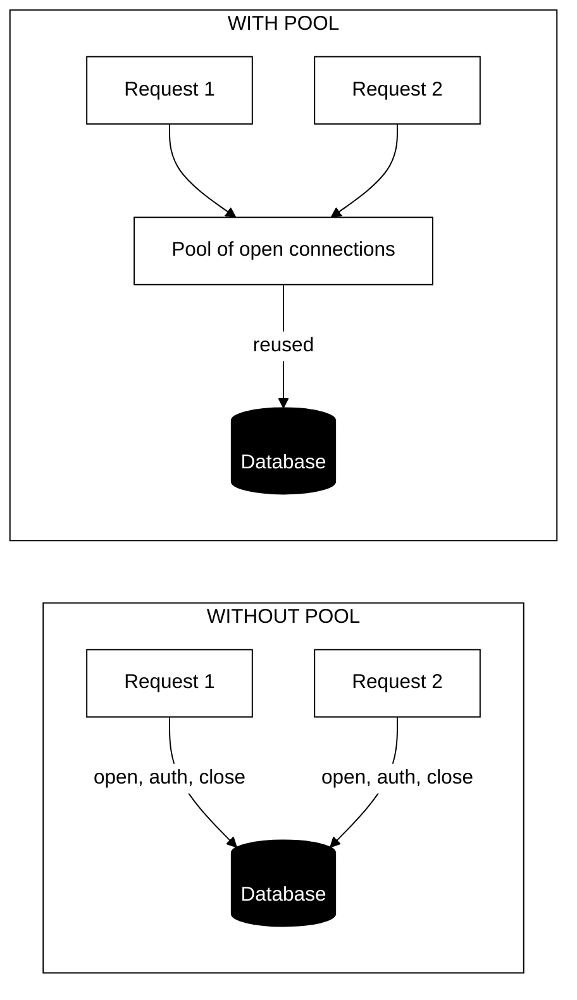
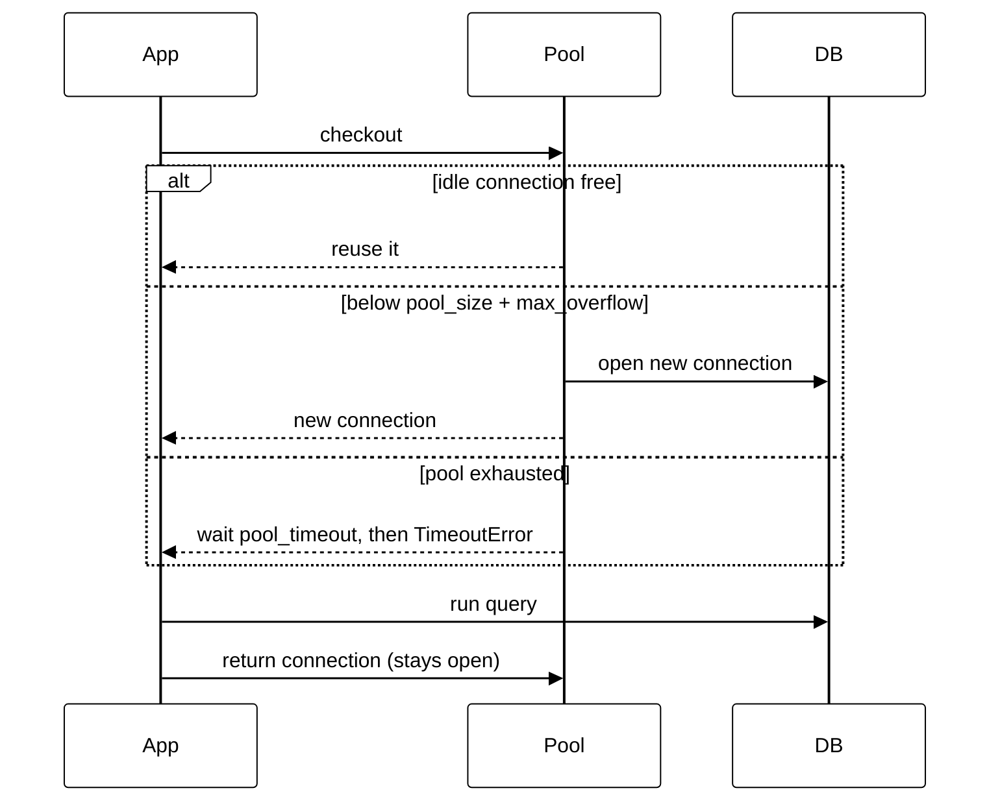
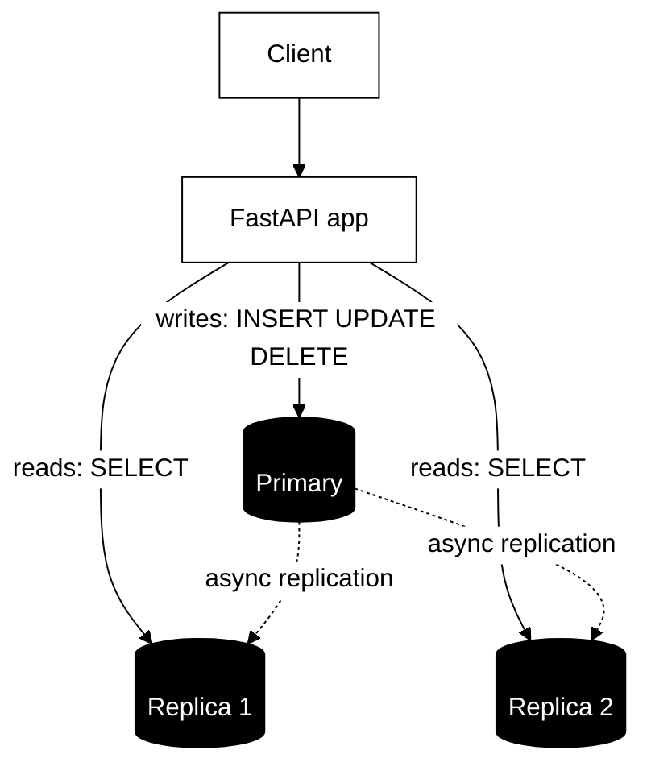
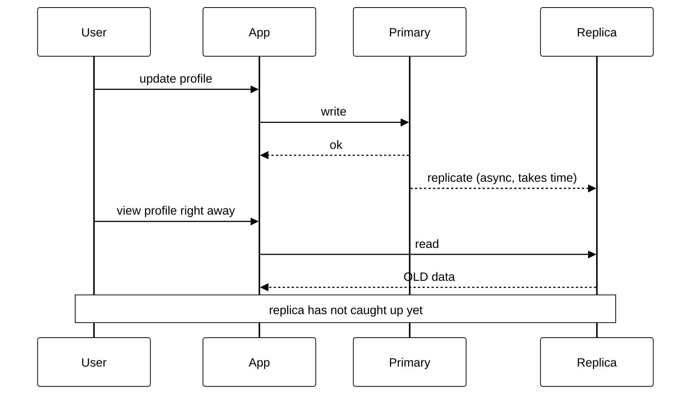
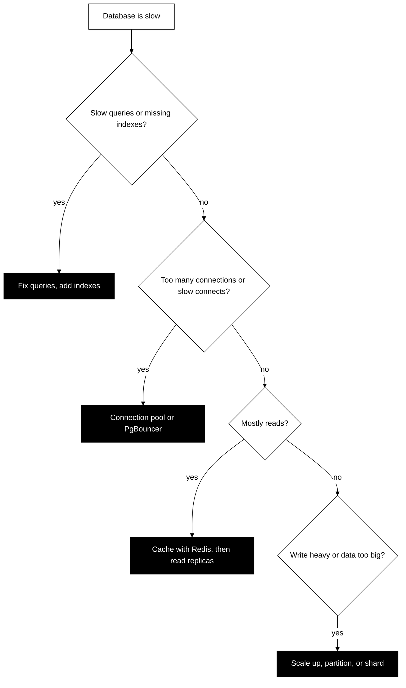

# Connection Pooling, Read Replicas & Scaling

*Backend & Production | short notes with black-and-white diagrams (Mermaid)*

## 1. Connection pooling

**Idea:** keep a set of already-open DB connections and reuse them, instead of opening and closing one per request.

**Why:** opening a connection costs a TCP handshake, TLS and authentication. A DB server also caps connections (Postgres default `max_connections` = 100), and each one uses real memory on the server.



### 1.1 Checkout lifecycle



### 1.2 SQLAlchemy pool settings

| Setting | Default | Meaning |
|---|---|---|
| `pool_size` | 5 | Connections kept open permanently |
| `max_overflow` | 10 | Extra temporary connections allowed above `pool_size` |
| `pool_timeout` | 30 s | How long a request waits for a free connection before erroring |
| `pool_recycle` | off | Replace connections older than N seconds (avoids stale ones) |
| `pool_pre_ping` | off | Test a connection before use; reconnect if dead |

**Budget rule:** `workers x (pool_size + max_overflow)` must stay below the DB `max_connections`. Example: 4 workers x (10 + 5) = 60, under 100. Each worker process has its own pool, so more workers means more connections.

### 1.3 PgBouncer (external pooler)

A separate proxy between your apps and Postgres. Many app connections go in, few DB connections come out.

| Mode | Connection held for | Note |
|---|---|---|
| Session | Whole client session | Safest, least saving |
| Transaction | One transaction | Most common; can break session state (`SET`, advisory locks, older prepared statements) |
| Statement | One statement | No multi-statement transactions |

## 2. Read replicas

**Idea:** one **primary** takes all writes. **Replicas** are copies kept up to date by replication and serve read-only queries. This scales reads, not writes.



### 2.1 The catch: replication lag

Replication is usually asynchronous, so a replica can be a moment behind the primary. A user who just wrote data may then read old data from a replica ("read-your-own-writes" problem).



**Fixes:** read from the primary right after a write, or for a short window after (sticky reads); send only lag-tolerant reads (feeds, reports, search) to replicas; monitor replica lag.

### 2.2 Routing reads and writes in FastAPI

```python
from fastapi import Depends, FastAPI
from sqlalchemy.ext.asyncio import async_sessionmaker, create_async_engine

# URLs come from BaseSettings, never hardcoded
write_engine = create_async_engine(settings.primary_url, pool_size=10, max_overflow=5, pool_pre_ping=True)
read_engine = create_async_engine(settings.replica_url, pool_size=10, max_overflow=5, pool_pre_ping=True)

WriteSession = async_sessionmaker(write_engine, expire_on_commit=False)
ReadSession = async_sessionmaker(read_engine, expire_on_commit=False)


async def get_write_db():
    async with WriteSession() as session:
        yield session


async def get_read_db():
    async with ReadSession() as session:
        yield session


app = FastAPI()


@app.get("/items")                                  # SELECT -> replica
async def list_items(db=Depends(get_read_db)): ...


@app.post("/items")                                 # INSERT -> primary
async def create_item(db=Depends(get_write_db)): ...
```

## 3. Which scaling tool when



| Tool | Fixes | Does not fix |
|---|---|---|
| Indexes / query tuning | Slow queries | Connection limits |
| Connection pool | Connect cost, too many connections | Slow queries |
| Caching (Redis) | Repeated identical reads | Writes |
| Read replicas | Read load on the primary | Write load, replication lag |
| Sharding | Write load, data size | Complexity (cross-shard queries, harder ops), so last resort |

## 4. AI and agent relevance

- **Do not hold a DB session open while waiting on an LLM call.** Slow model responses pin connections, the pool empties, and unrelated requests start timing out. Open a short session, read or write, close it, then call the model.
- **Pool exhaustion is a denial-of-service route.** A flood of slow requests can drain the pool without any crash. Pair pool limits with rate limiting.
