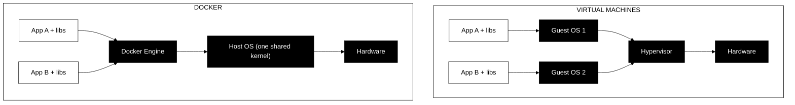
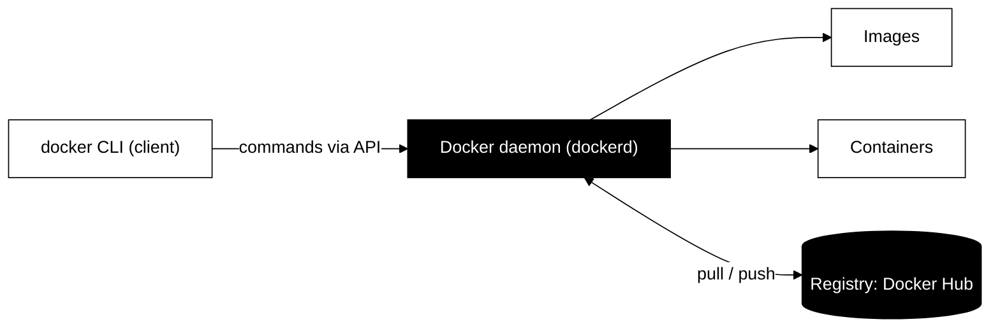
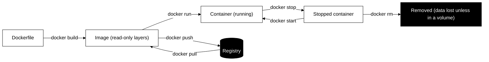
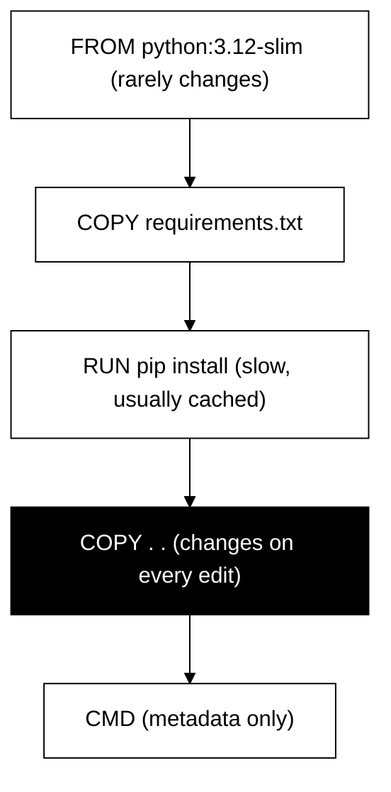
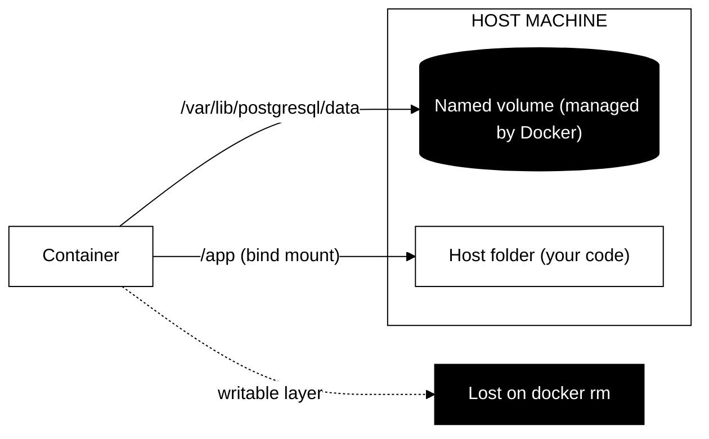
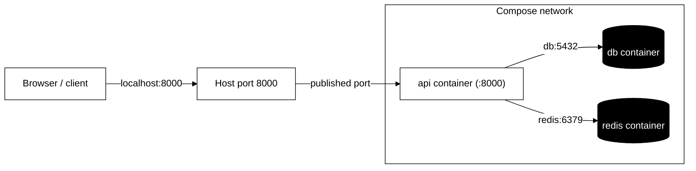
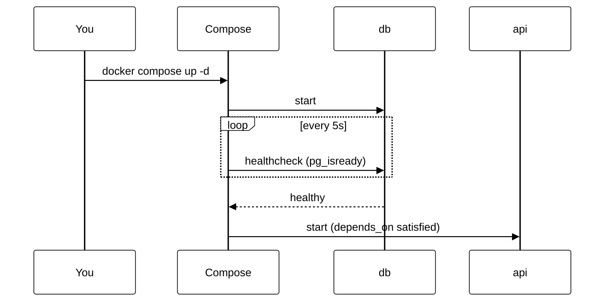

# Docker Deep Dive & Docker Compose

*Backend & Production | notes with black-and-white diagrams (Mermaid)*

## 1. What Docker is

**Docker** packages an app with everything it needs (runtime, libraries, config) into a **container** that runs the same on any machine. Containers share the host's OS kernel, so they start in about a second and are far lighter than virtual machines. Where a VM virtualizes hardware, Docker virtualizes the operating system.



| | Virtual machine | Container |
|---|---|---|
| Isolates | Hardware (own full OS) | Processes (shared kernel) |
| Startup | Minutes | About a second |
| Size | GBs | MBs |
| Isolation strength | Stronger | Weaker (shared kernel), so harden it |

Linux containers need a Linux kernel. On Windows, Docker Desktop runs them through WSL2.

## 2. Architecture and terminology



| Term | Meaning |
|---|---|
| **Image** | Read-only template: OS files, your code, dependencies. Built from a Dockerfile. |
| **Container** | A running (or stopped) instance of an image, with a thin writable layer on top. |
| **Dockerfile** | Text recipe of instructions that builds an image. |
| **Layer** | One filesystem step in an image. Layers are cached and shared. |
| **Registry** | Server that stores images (Docker Hub, GitHub Container Registry, AWS ECR). |
| **Tag** | Version label, `image:tag` (for example `python:3.12-slim`). Default is `latest`. |
| **Volume** | Docker-managed storage that outlives the container. |
| **Network** | Virtual network that lets containers talk to each other. |
| **Compose** | Tool that defines and runs several containers from one YAML file. |

### 2.1 Image to container lifecycle



## 3. Core commands

| Command | What it does |
|---|---|
| `docker pull python:3.12-slim` | Download an image |
| `docker build -t myapp:1.0 .` | Build an image from the Dockerfile in this folder |
| `docker run -d -p 8000:8000 --name api myapp:1.0` | Run detached, map host port 8000 to container port 8000 |
| `docker ps` / `docker ps -a` | List running / all containers |
| `docker logs -f api` | Follow a container's logs |
| `docker exec -it api sh` | Open a shell inside a running container |
| `docker stop api` / `docker start api` | Stop / start |
| `docker rm api` / `docker rmi myapp:1.0` | Remove a container / an image |
| `docker stats` | Live CPU and memory per container |
| `docker system prune` | Delete unused containers, networks and dangling images |

Useful `run` flags: `-d` detached, `-p host:container` publish a port, `-e KEY=val` env var, `-v` mount storage, `--rm` delete when it exits, `--network` pick a network.

## 4. Dockerfile

```dockerfile
FROM python:3.12-slim                 # base image (slim = smaller)
WORKDIR /app                          # all later paths are relative to /app

COPY requirements.txt .               # copy ONLY dependencies first
RUN pip install --no-cache-dir -r requirements.txt   # slow step, now cached

COPY . .                              # your code (changes often, so it goes last)

RUN useradd --create-home appuser     # do not run as root
USER appuser

EXPOSE 8000                           # documentation only, does not publish the port
CMD ["uvicorn", "main:app", "--host", "0.0.0.0", "--port", "8000"]
```

`--host 0.0.0.0` matters: the default `127.0.0.1` listens only inside the container, so nothing outside can reach it.

| Instruction | Purpose |
|---|---|
| `FROM` | Base image |
| `WORKDIR` | Set the working directory |
| `COPY` | Copy files from your machine into the image (prefer over `ADD`) |
| `RUN` | Execute a command **at build time** (install packages) |
| `CMD` | Default command **at container start**; easy to override |
| `ENTRYPOINT` | Fixed executable; `CMD` becomes its default arguments |
| `ENV` | Set an environment variable (stored in the image, so no secrets) |
| `EXPOSE` | Document the port the app listens on |
| `USER` | Switch to a non-root user |

### 4.1 Layers and build cache

Each instruction makes a layer. If a layer is unchanged, Docker reuses the cached one. A change rebuilds that layer **and every layer after it**, so put rarely-changing steps first.



If `COPY . .` came before `pip install`, every code edit would reinstall all dependencies.

### 4.2 `.dockerignore` and multi-stage builds

`.dockerignore` keeps files out of the build context (and out of the image):

```
venv/
__pycache__/
*.pyc
.git
.env
agent.log
```

A **multi-stage build** compiles or installs in one stage and copies only the result into a clean final image, giving a smaller image with no build tools in it:

```dockerfile
FROM python:3.12-slim AS builder
WORKDIR /app
COPY requirements.txt .
RUN pip install --no-cache-dir --prefix=/install -r requirements.txt

FROM python:3.12-slim
WORKDIR /app
COPY --from=builder /install /usr/local
COPY . .
CMD ["uvicorn", "main:app", "--host", "0.0.0.0", "--port", "8000"]
```

## 5. Volumes and bind mounts

A container's writable layer is **deleted with the container**. Anything that must survive (database files, uploads) goes in a volume.



| Type | Syntax | Use for |
|---|---|---|
| Named volume | `-v pgdata:/var/lib/postgresql/data` | Databases, persistent data (Docker manages the location) |
| Bind mount | `-v ./src:/app` | Development: edit code on the host, container sees it instantly |
| tmpfs | `--tmpfs /tmp` | Temporary data kept in memory only |

## 6. Networking

- **Port publishing** (`-p 8000:8000`, host:container) opens a container to the outside world. Without it, the container is reachable only from other containers.
- On a **user-defined network** (Compose creates one automatically), containers reach each other by **service name**, such as `db` or `redis`. `localhost` inside a container means that container itself.



Only `api` is published. `db` and `redis` have no `ports:` entry, so the outside world cannot reach them.

| Network driver | Meaning |
|---|---|
| `bridge` | Default. Private network on one host. |
| `host` | Container shares the host's network (no isolation, Linux only) |
| `none` | No networking |

## 7. Docker Compose

Compose describes a whole stack in one `compose.yaml` and starts it with one command.

```yaml
services:
  api:
    build: .                          # build from the Dockerfile here
    ports:
      - "8000:8000"                   # only the API is published
    env_file: .env
    depends_on:
      db:
        condition: service_healthy    # wait until the DB is actually ready
      redis:
        condition: service_started

  db:
    image: postgres:16
    environment:
      POSTGRES_PASSWORD: ${DB_PASSWORD}     # read from .env, not hardcoded
    volumes:
      - pgdata:/var/lib/postgresql/data     # data survives container removal
    healthcheck:
      test: ["CMD-SHELL", "pg_isready -U postgres"]
      interval: 5s
      timeout: 3s
      retries: 5

  redis:
    image: redis:7

volumes:
  pgdata:
```

Inside this stack the API connects with `postgresql+asyncpg://postgres:<password>@db:5432/app` and `redis://redis:6379`, using service names, never `localhost`.



`depends_on` alone only waits for the container to **start**, not for the database inside it to be **ready**. The `healthcheck` plus `condition: service_healthy` fixes that.

| Command | What it does |
|---|---|
| `docker compose up -d` | Build if needed, create and start everything in the background |
| `docker compose up -d --build` | Force a rebuild first |
| `docker compose ps` | Status of the stack |
| `docker compose logs -f api` | Follow one service's logs |
| `docker compose exec api sh` | Shell into a service |
| `docker compose down` | Stop and remove containers and the network (volumes are kept) |
| `docker compose down -v` | Same, and **also deletes volumes** (database data gone) |

Use `docker compose` (v2, with a space). The old `docker-compose` binary is legacy, and the `version:` line at the top of the file is no longer needed.

## 8. Common pitfalls

| Pitfall | Why it hurts | Fix |
|---|---|---|
| `localhost` between containers | Points to the container itself | Use the service name (`db`) |
| App binds to `127.0.0.1` | Unreachable from outside the container | `--host 0.0.0.0` |
| `COPY . .` before dependencies | Reinstalls everything on every edit | Copy `requirements.txt` first |
| Using `latest` tag | Builds change without warning | Pin versions (`postgres:16`, `python:3.12-slim`) |
| Data in the container layer | Lost on `docker rm` | Named volume |
| `depends_on` without healthcheck | App starts before DB is ready | `condition: service_healthy` |
| `docker compose down -v` by habit | Deletes the database | Use plain `down` unless you want a reset |
| Huge images | Slow pulls, bigger attack surface | `-slim` base, multi-stage, `.dockerignore` |

## 9. Security and AI-agent relevance

- **Secrets must never be baked into an image.** `ENV` and `COPY .env` store values in layers, and anyone who can pull the image can read them. Pass secrets at runtime (`env_file`, orchestrator secrets) and keep `.env` in `.dockerignore`.
- **Run as non-root and never mount `/var/run/docker.sock` into a container.** Root in a container plus the Docker socket is effectively root on the host.
- **Containers are the standard sandbox for AI agents.** Running an agent's tool execution in a container with no published ports, a read-only filesystem and resource limits (`--memory`, `--cpus`) limits the damage if a prompt injection makes it run something harmful. This is the same idea AgentScan-style testing targets.
